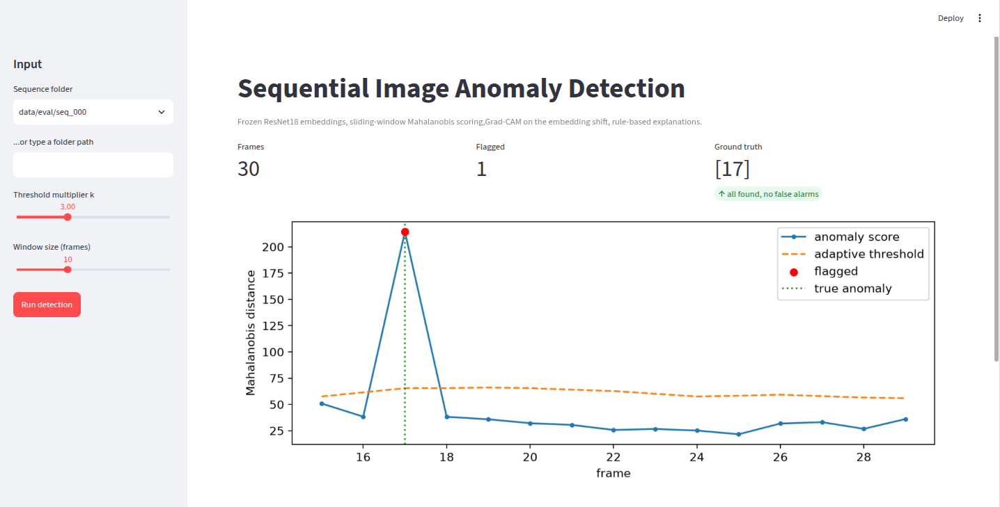
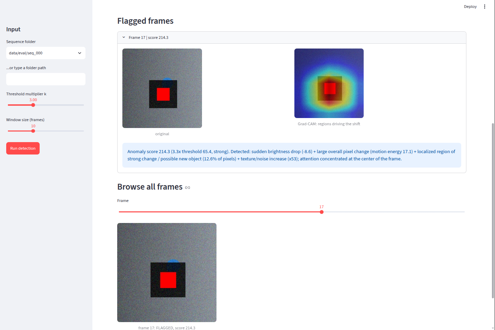

# Sequential Image Anomaly Detection with Visual & Text Explanations

Detects unusual frames in an image sequence and explains *why*: a heatmap of the regions driving the change, plus a plain-English sentence.

<p align="center">
  
  
</p>

> Example output: *"Anomaly score 214.3 (3.3x threshold 65.4, strong). Detected: sudden brightness drop (-8.6) + large overall pixel change (motion energy 17.1) + localized region of strong change / possible new object (12.6% of pixels) + texture/noise increase (x53); attention concentrated at the center of the frame."*

## How it works

1. **Features:** a frozen ImageNet ResNet18 turns each frame into a 512-d embedding (224x224 resize, no crop, so edge anomalies aren't cut off).
2. **Temporal scoring:** each new frame is scored by its Mahalanobis distance to a sliding window of recent *normal* embeddings (Ledoit-Wolf shrinkage, because 10 samples in 512 dimensions make the plain covariance singular).
3. **Adaptive threshold:** median + k x MAD of recent normal scores, with a relative floor. Flagged frames are held back from the window; if 3 consecutive frames are flagged, the change is accepted as a new normal (this prevents the scorer locking itself out after a regime change or drift).
4. **Visual explanation:** Grad-CAM on ResNet's last conv block, but targeted at the *direction the embedding moved* (current - window mean) rather than at an ImageNet class, so it highlights what drives the anomaly rather than what the classifier sees.
5. **Text explanation:** rules over brightness change, motion energy, share of strongly changed pixels (localized vs whole-frame), texture (Laplacian variance) change, and where the heatmap is concentrated.
6. **UI:** Streamlit app with score timeline, flagged frames, heatmaps, explanations and a frame browser.

## Results (synthetic benchmark)

50 generated sequences x 30 frames (seeds 1000-1049), 10 per anomaly type, one injected anomaly each. The detector settings were developed on a different set of seeds.

| method | precision | recall | F1 | false alarms |
|---|---|---|---|---|
| **CNN + Mahalanobis (this project)** | 0.962 | 1.000 | 0.980 | 2 |
| Pixel-space Mahalanobis (16x16 gray) | 0.336 | 0.940 | 0.495 | 93 |
| Pixel difference | 0.652 | 0.600 | 0.625 | 16 |

Recall by anomaly type (found / total): the CNN scorer finds 10/10 for all five types (combo, dark patch, new object, brightness drop, noise). Pixel-space Mahalanobis misses 3 of 10 noise sequences. Pixel difference finds 0/10 new-object and 0/10 noise anomalies.

**Sensitivity to k:** results are identical for k = 3.0, 3.5 and 4.0 (precision 0.962, recall 1.000); k = 2.0 gives 33 false alarms; k = 5.0 starts missing anomalies (recall 0.94).

**Localization** (30 localized anomalies): the Grad-CAM peak falls inside the true anomaly box in 30/30 cases, and 33-39% of the heatmap mass lies inside a box covering about 12% of the frame (about 3x chance). The explanation's region label (3x3 grid) matches the true cell in 80% of cases (always saying "center" would be right 30% of the time; using the single peak pixel, 53%).

Grad-CAM targets the gradient of the Mahalanobis score (P(x − μ)) rather than the raw embedding shift. Compared on 30 localized anomalies, the two gave the same region-label accuracy within noise (83% vs 80% exact cell, a difference of one sequence); the score gradient is used because it is what the detector actually responds to. With only 10 frames in the window, covariance shrinkage keeps the two directions close.

Full tables: [`docs/eval_results.md`](docs/eval_results.md), [`docs/eval_regions.md`](docs/eval_regions.md).

## Limitations

- **Synthetic data only.** The anomalies are blunt and generated by the same code that tuned the detector's defaults; real footage (lighting changes, camera motion, subtle events) is untested.
- **Small benchmark:** 50 sequences, one anomaly each, so 2 false alarms and 50/50 recall come with wide error bars.
- **The pixel baselines are handicapped** by 16x16 grayscale downsampling, which averages away noise grain and shrinks the small object; they are not tuned methods, so the comparison shows what CNN features add under identical settings, not that pixels cannot work.
- Grad-CAM works on a 7x7 grid (about 32x32 px per cell), so heatmaps are blobby.
- The text rules' thresholds are hand-set for this data.
- Whole-frame changes (brightness, noise) have no meaningful spatial attention; the explanation says so instead of pointing somewhere.
- The scorer needs 15 frames of history before it can flag anything.
- **Warm-up blind spot:** the first 15 frames build the model of “normal”, so an anomaly inside them is absorbed into it (and can make later detection less sensitive). Sequences should start clean.
- **Lasting anomalies become normal:** a change flagged on 3 consecutive frames is accepted as the new normal (intentional, for drift and regime changes), so the system detects onsets, not sustained states.

## Quick start

```bash
git clone https://github.com/mrudulaa11/sequential-anomaly-detector.git
cd sequential-anomaly-detector
python3 -m venv .venv && source .venv/bin/activate

pip install torch torchvision --index-url https://download.pytorch.org/whl/cpu
pip install -r requirements.txt

python -m src.utils.generate_synthetic --num-seqs 5 --kind mixed --seed 10
python -m src.detect data/synthetic/seq_000 --explain
streamlit run app/app.py
```

Reproduce the evaluation (about 20 minutes on CPU):

```bash
python -m src.evaluate --num-seqs 50
python -m src.eval_regions
```

## Project structure

```
src/
  models/feature_extractor.py   frozen ResNet18 embeddings
  models/anomaly_scorer.py      sliding-window Mahalanobis scorer, adaptive threshold
  explain/gradcam_explainer.py  Grad-CAM on the embedding shift
  explain/text_explainer.py     rule-based text explanation
  utils/generate_synthetic.py   sequences with known injected anomalies
  detect.py                     pipeline + CLI
  evaluate.py, eval_regions.py  benchmark and localization checks
app/app.py                      Streamlit demo
docs/                           screenshots and evaluation results
```

## Possible extensions

Real-footage benchmark, Isolation Forest / autoencoder scorers, multiple anomalies per sequence, higher-resolution attribution maps.